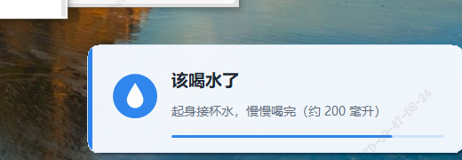
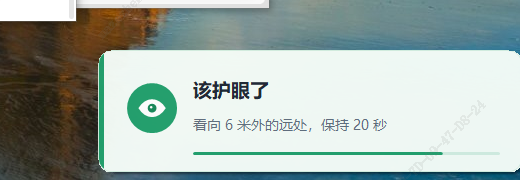

# 喝水 / 护眼提醒

> 一个 400 KB 的 Windows 小工具：到点在你屏幕**右下角**弹一张小卡片，提醒喝水、远眺。
> 不抢焦点、不出声、不用点确定——25 秒后它自己淡出，你继续干活。




适合每天要对着电脑坐六小时以上、又总忘记起身的人。装上就不用管，它比你记得住。

---

## 为什么用它，而不是手机闹钟

| | 手机闹钟 | 本工具 |
|---|---|---|
| 提醒方式 | 「叮」一声，你得拿手机看 | 卡片直接出现在屏幕角落，抬眼就看到 |
| 打断工作 | 要解锁手机 | 不抢焦点，你正在打的字不会断 |
| 关掉它 | 每次都要点 | 不点也行，自动淡出 |
| 隐私 | 要装 App、可能联网 | **不联网、不收集任何数据、不写注册表** |

## 特点

- **右下角**圆角卡片，贴在任务栏上方，不挡工作区
- **不抢焦点**：弹出时你正在打的字不会断（`WS_EX_NOACTIVATE`）
- **无声音、无需确认**，停留 25 / 20 秒后自动淡出（可改）
- **对齐钟点**：喝水 `:00` `:30`，护眼 `:00` `:20` `:40`；也可改成"从启动开始按间隔"
- **文案可改**：托盘菜单「编辑提醒词…」，四个格子随你改，能一键恢复默认
- **单文件 exe**：.NET Framework 4.x（Win10/11 自带），约 400 KB，无安装、无依赖、不联网
- **多显示器 / 高 DPI**：声明 Per-Monitor DPI 感知，100%~200% 缩放都不会跑偏

## 系统要求

- Windows 10 / 11（x64 或 x86 均可）
- 不需要装 .NET 运行时（系统自带 .NET Framework 4.x）
- 不需要管理员权限

## 安装

没有安装程序，就是一个 exe：

1. 下载 Release 里的 `喝水护眼提醒.exe`
2. 放到你喜欢的位置（比如 `D:\tools\`）
3. 双击运行，右下角出现小水滴图标

> **图标被折叠进 `^` 里了？** Windows 默认这么干。
> 设置 → 个性化 → 任务栏 → 「选择哪些图标显示在任务栏上」→ 打开本程序。

## 卸载

- 托盘右键 → 退出
- 把 exe 和 `ReminderApp.ini` 删掉
- 如果你开过「开机自动启动」，先在托盘里关掉它（它只写一个 `HKCU\Software\Microsoft\Windows\CurrentVersion\Run` 项，关掉即清理）

## 使用

托盘图标右键菜单：

| 菜单项 | 作用 |
|---|---|
| 下次喝水 / 下次护眼 | 显示下次时间（不会误点） |
| 现在弹一次：喝水 / 护眼 | 立刻预览一张卡片 |
| 编辑提醒词… | 打开设置窗口，改四个文案格子（可恢复默认） |
| 重新读取配置 | 手动改过 ini 后，让它立刻生效 |
| 暂停提醒 / 恢复提醒 | 临时关掉 |
| 开机自动启动 | 开关本机自启 |
| 退出 | 关掉程序 |

## 配置

「编辑提醒词…」只管文案；间隔、停留秒数在 `ReminderApp.ini` 里改（改完点「重新读取配置」）：

```ini
water_minutes=30      # 喝水间隔（分钟，建议能整除 60）
eye_minutes=20        # 护眼间隔
align_clock=true      # true = 对齐钟点；false = 从启动时刻起按间隔

water_seconds=25      # 卡片停留（秒）
eye_seconds=20

water_title=该喝水了
water_text=起身接杯水，慢慢喝完（约 400 毫升）
eye_title=该护眼了
eye_text=看向 6 米外的远处，保持 20 秒
```

删掉 ini 再启动，会自动生成一份默认配置。

## 自己编译

不需要 Visual Studio，Windows 自带的 .NET Framework 4.x 就够：

```powershell
powershell -ExecutionPolicy Bypass -File .\build.ps1                  # 输出到当前文件夹
powershell -ExecutionPolicy Bypass -File .\build.ps1 -OutDir D:\tools # 输出到指定目录
```

脚本会先生成 `app.ico`（9 种尺寸），再用系统自带的 `csc.exe` 编译 `ReminderApp.cs`。

## 常见问题

**提醒没出现？**
先看托盘图标还在不在。到点才弹，中间不会打扰你。

**电脑睡眠醒来后？**
如果已经过了某个钟点，会立刻弹一次，然后继续按钟点走，不会补一串。

**改文案不生效？**
点「重新读取配置」，或者退出重开。

**Windows 提示「未知发布者」/ 杀毒软件报毒？**
因为 exe 没有代码签名证书（个人项目，买证书要一年几千）。源码就一个文件，全部在 `ReminderApp.cs` 里，可以自己审、自己 `build.ps1` 编译。介意的话用自己编译的版本。

**双击两次会不会开两个？**
不会。第二次双击只会弹一张「正在运行」的提示卡。

## 目录

| 文件 | 说明 |
|---|---|
| `ReminderApp.cs` | 全部源码（单文件：WinForms 自绘卡片 + 托盘 + 计时） |
| `ReminderApp.ini` | 配置 |
| `build.ps1` | 生成图标 + 编译 |
| `docs/` | 截图 |

## 实现要点

- 托盘 + 两个对齐到钟点的计时器，到点创建一张无边框卡片窗口
- 卡片用 `WS_EX_NOACTIVATE | WS_EX_TOOLWINDOW` + `ShowWithoutActivation`，从不抢焦点、不进 Alt+Tab
- 位置取 `Screen.PrimaryScreen.WorkingArea`（已排除任务栏），进程声明 Per-Monitor DPI 感知
- 文案太长会自动缩字号，保证不溢出卡片
- 两张卡片同时到点会自动往上叠，不重叠
- 再次双击 exe 时通过命名事件通知已运行实例，不会起第二个进程

## 需要定制

这个工具的代码量很小，改起来快。可以定制的地方：

- 提醒内容换成你的（喝水/久坐/吃药/打卡/会议前提醒）
- 时间安排换成你的作息（工作时段自动暂停、午休不打扰）
- 换成公司内部版本（统一文案、统一图标、批量部署）

有需要就在 Issues 里留言，说清楚想改成什么样、给谁用、几台机器。

## License

MIT
